# Tutorial de Configuração Azure SQL

> **Objetivo:** praticar a configuração e implantação de uma instância
> de banco de dados na Microsoft Azure e registrar resumos, anotações e
> dicas que sirvam como material de apoio para estudos e futuras
> implementações.

**Nível:** intermediário - pressupõe familiaridade básica com bancos
de dados, SQL, conceitos de cloud e navegação em portais web.

------------------------------------------------------------------------

## Sumário

-   [1. Preparação: GitHub](#1-preparação-github)
-   [2. Objetivo e visão geral](#2-objetivo-e-visão-geral)
-   [3. Pré-requisitos](#3-pré-requisitos)
-   [4. Conceitos importantes](#4-conceitos-importantes)
-   [5. Criar a instância no Portal
    Azure](#5-criar-a-instância-no-portal-azure)
    -   [5.1. Básico](#51-básico)
    -   [5.2. Computação e
        armazenamento](#52-computação-e-armazenamento)
    -   [5.3. Rede](#53-rede)
    -   [5.4. Segurança e configurações
        adicionais](#54-segurança-e-configurações-adicionais)
    -   [5.5. Revisar e implantar](#55-revisar-e-implantar)
-   [6. Acompanhar a implantação](#6-acompanhar-a-implantação)
-   [7. Criar um banco de dados](#7-criar-um-banco-de-dados)
-   [8. Obter informações de conexão](#8-obter-informações-de-conexão)
-   [9. Segurança: boas práticas](#9-segurança-boas-práticas)
-   [10. Custos e limpeza dos
    recursos](#10-custos-e-limpeza-dos-recursos)
-   [11. Referências](#11-referências)

------------------------------------------------------------------------

## 1. Preparação: GitHub

Antes de iniciar, caso precise de uma revisão sobre criação de
repositórios, commits e publicação de arquivos, consulte o material:

-   [GitHub Quickstart --- Digital Innovation
    One](https://github.com/digitalinnovationone/github-quickstart)

Use o GitHub para registrar os passos realizados, documentar
aprendizados e manter evidências do exercício.

## 2. Objetivo e visão geral

Neste exercício, será criada uma **Azure SQL Managed Instance**, serviço
de banco de dados relacional gerenciado baseado no mecanismo SQL Server.

O serviço oferece alta compatibilidade com SQL Server e recursos de
gerenciamento simplificados pela Azure. Diferentemente de uma instalação
tradicional em máquina virtual, a infraestrutura subjacente é
administrada pela plataforma.

### Etapas do exercício

1.  Criar ou selecionar uma assinatura e um grupo de recursos.
2.  Definir os parâmetros da instância.
3.  Configurar computação, armazenamento e rede.
4.  Validar e iniciar a implantação.
5.  Acompanhar o provisionamento.
6.  Criar um banco de dados.
7.  Consultar as informações necessárias para conexão.

> **Atenção:** os nomes das opções e telas podem mudar conforme
> atualizações do Portal Azure, região e tipo de assinatura.

## 3. Pré-requisitos

-   Conta e assinatura Azure com permissões para criar recursos.
-   Permissão apropriada, geralmente a função **SQL Managed Instance
    Contributor**, ou permissões equivalentes.
-   Região Azure que ofereça suporte ao serviço.
-   Conhecimentos básicos de SQL Server, redes virtuais e grupos de
    recursos.
-   Um cliente SQL para testes, como SQL Server Management Studio (SSMS)
    ou Azure Data Studio/alternativa compatível.

Confira os requisitos e limitações atualizados na [documentação
oficial](https://learn.microsoft.com/pt-br/azure/azure-sql/managed-instance/instance-create-quickstart?view=azuresql).

## 4. Conceitos importantes

  | Conceito                         |              Descrição            |
  | -------------------------------- | --------------------------------- |
  |  Azure SQL Managed Instance      | Serviço gerenciado de banco relacional baseado no SQL Server.|
  |  Resource Group                  | Contêiner lógico para organizar recursos Azure relacionados. |
  |  Região                          | Localização geográfica onde os recursos são implantados.     |
  |  vCores                          | Capacidade de computação provisionada para a instância.      |
  |  VNet (Virtual Network)          | Rede virtual que fornece isolamento e conectividade.         |
  |  Subnet                          | Segmento de uma VNet. A Managed Instance exige uma subnet apropriada e delegada ao serviço. |
  |  NSG (Network Security Group)    | Regras que controlam o tráfego de rede permitido ou bloqueado. |
  |  Endpoint                        | Endereço utilizado para acessar o serviço, conforme o tipo de conectividade configurado. |

## 5. Criar a instância no Portal Azure

Acesse o [Portal Azure](https://portal.azure.com/), procure por **Azure
SQL** e selecione **SQL managed instances / Instâncias gerenciadas
SQL**. Clique em **Criar**.

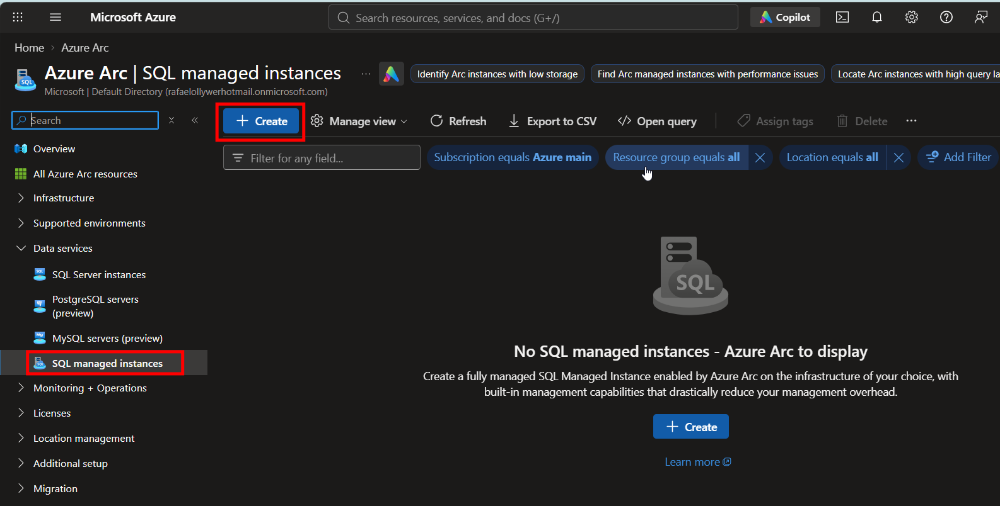

### 5.1. Básico

Preencha os dados essenciais:

-   **Subscription:** selecione sua assinatura.
-   **Resource group:** escolha um grupo existente ou crie um para o
    exercício.
-   **Managed Instance name:** defina um nome único e válido.
-   **Region:** selecione uma região disponível e adequada.
-   **Authentication:** escolha o método de autenticação. Para
    laboratório, a autenticação SQL pode ser utilizada conforme o guia,
    mas considere Microsoft Entra ID para cenários mais seguros.
-   **Admin login / Password:** configure as credenciais
    administrativas, respeitando os requisitos de complexidade.

**Dica:** utilize nomes padronizados, por exemplo, `rg-lab-azure-sqlmi`
para o grupo de recursos e `sqlmi-lab-estudos` para a instância, se
disponíveis e aceitos pelas regras de nomenclatura.

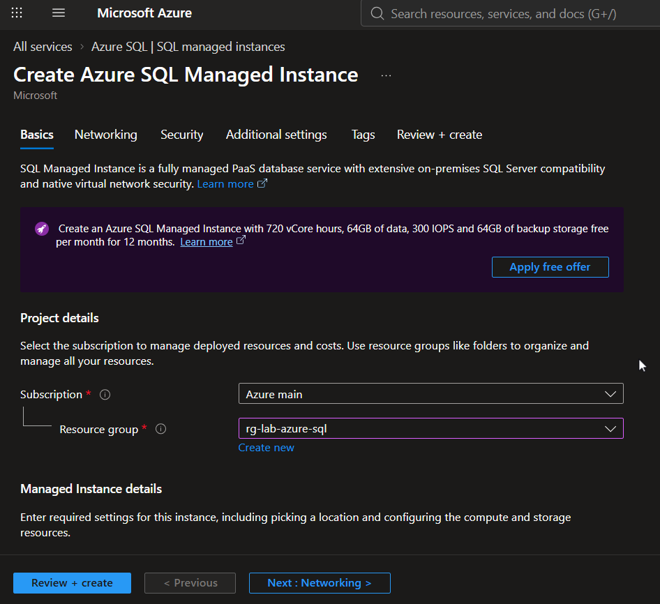
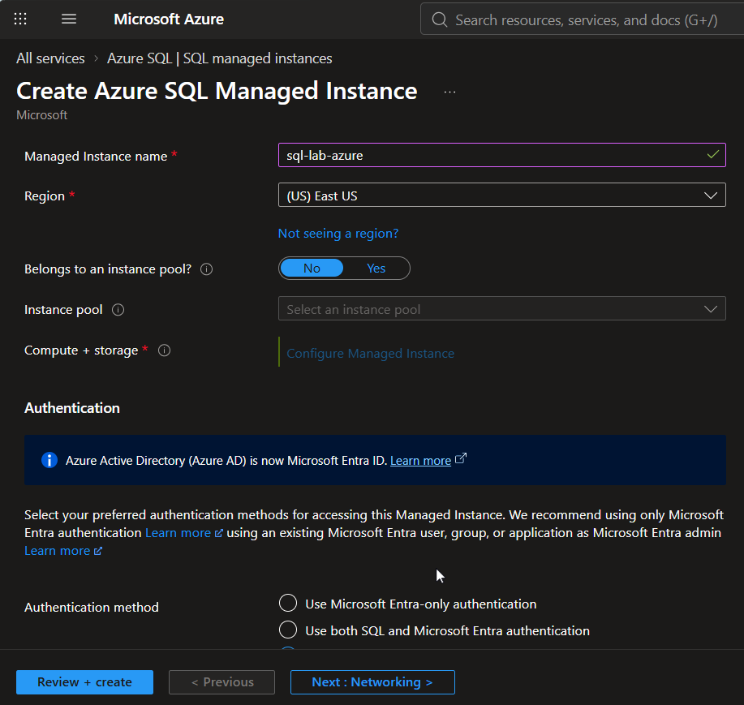
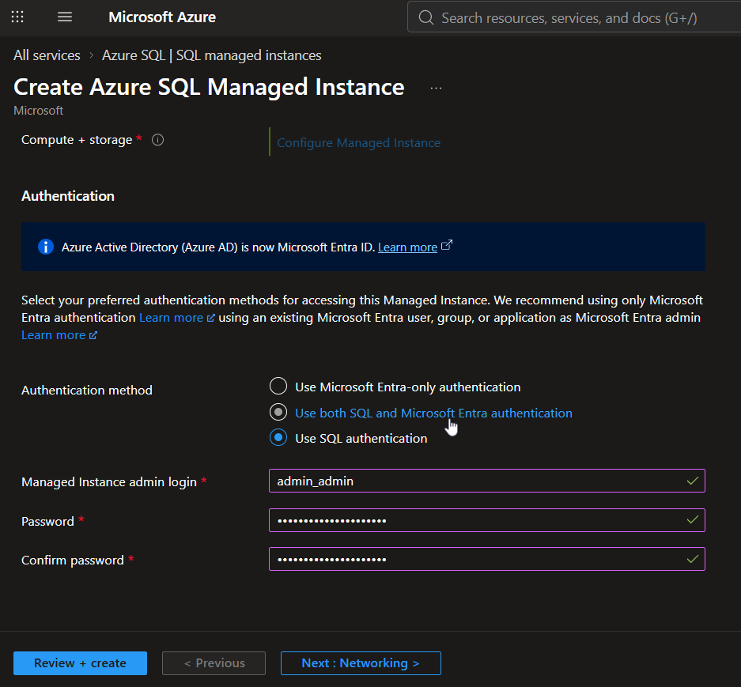

### 5.2. Computação e armazenamento

Na opção **Configure Managed Instance / Computação + armazenamento**,
selecione os parâmetros de acordo com o objetivo do laboratório:

-   **Service tier:** General Purpose é uma opção comum para cenários
    gerais.
-   **Hardware generation:** escolha uma geração disponibilizada na
    região.
-   **vCores:** dimensione de acordo com a necessidade e orçamento.
-   **Storage:** defina o armazenamento necessário para o exercício.
-   **Licensing:** confira as opções de licenciamento disponíveis e
    aplicáveis.
-   **Backup storage redundancy:** avalie a redundância de backups.

> Para laboratório, escolha a configuração de menor custo que esteja
> disponível e atenda aos requisitos. Confira o preço estimado antes de
> implantar: o serviço pode gerar custos significativos.

> OBS.: Optei pelas configurações padrões.

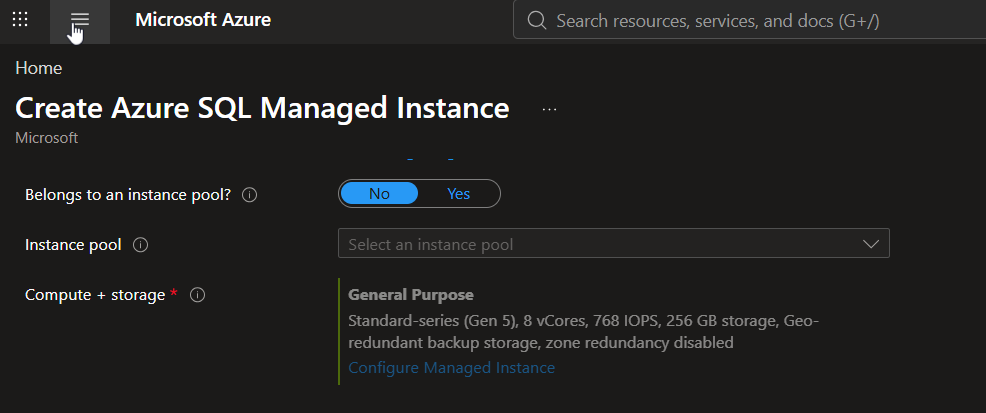

### 5.3. Rede

A Managed Instance é implantada em uma rede virtual e subnet
compatíveis.

-   Selecione uma VNet e subnet existentes ou crie uma configuração nova
    conforme o assistente.
-   Verifique se a subnet atende aos requisitos da Managed Instance e
    possui a delegação necessária.
-   Avalie o tipo de conexão.
-   Para este exercício, mantenha o **Public endpoint desabilitado**,
    salvo se houver necessidade específica e se você souber configurar
    as restrições de acesso.
-   Se habilitar endpoint público, revise cuidadosamente as regras de
    rede e os controles de acesso.

A configuração de rede é uma das partes mais importantes do exercício.
Não exponha o banco indiscriminadamente à internet.

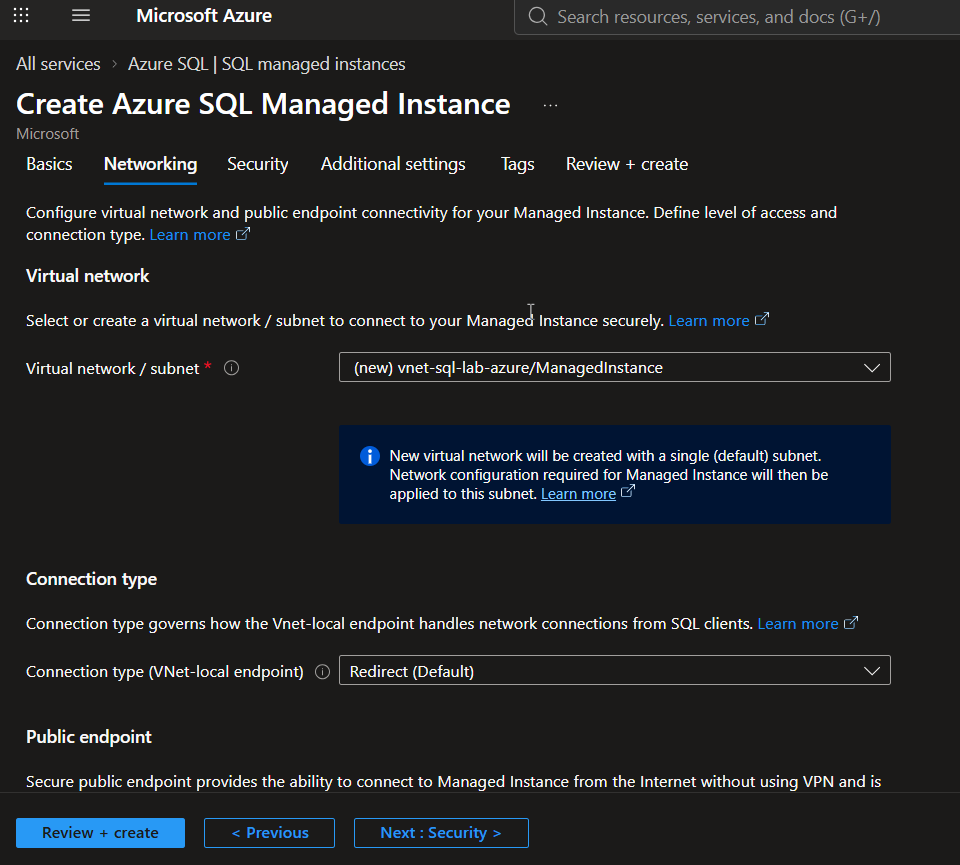
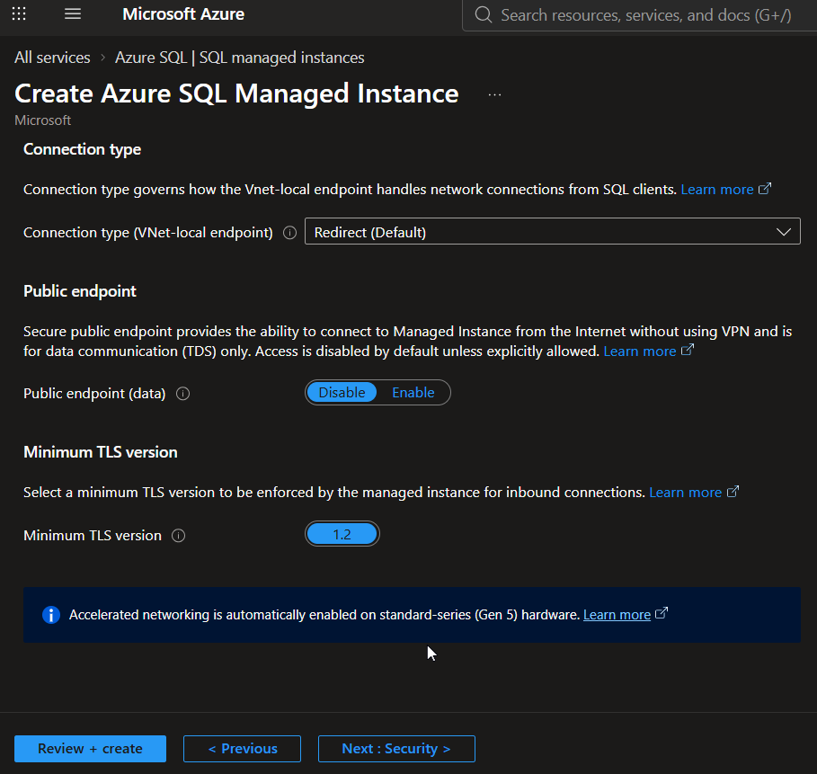

### 5.4. Segurança e configurações adicionais

Revise as opções disponíveis, que podem incluir:

-   Configurações de segurança e autenticação.
-   Collation.
-   Fuso horário.
-   Manutenção e política de atualização.
-   Geo-replicação, quando aplicável.
-   Tags para organização e controle de custos.

Para um laboratório simples, mantenha opções adicionais nos valores
padrão quando não houver uma necessidade específica, mas revise o que
será criado.

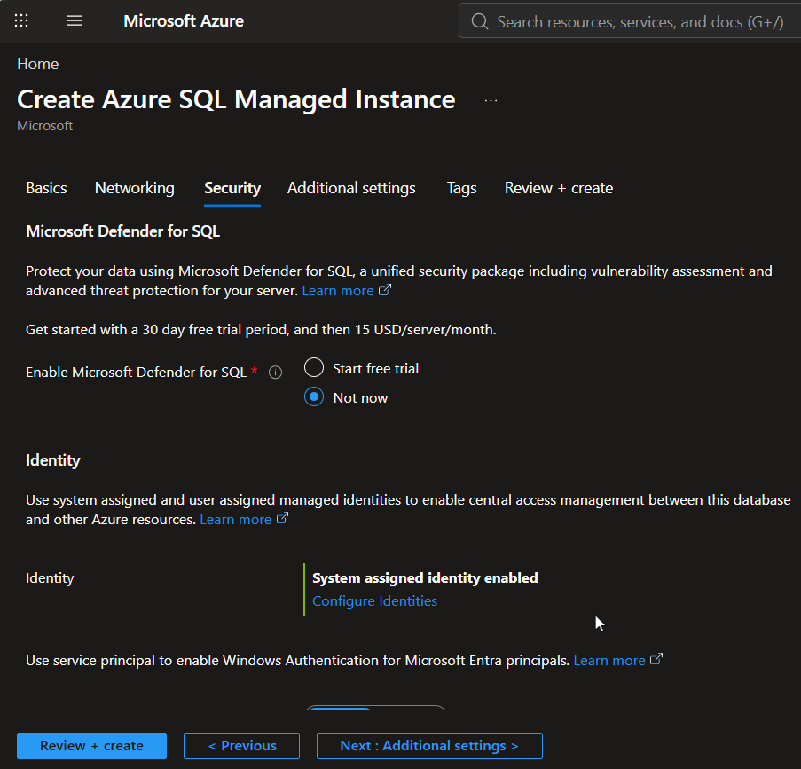
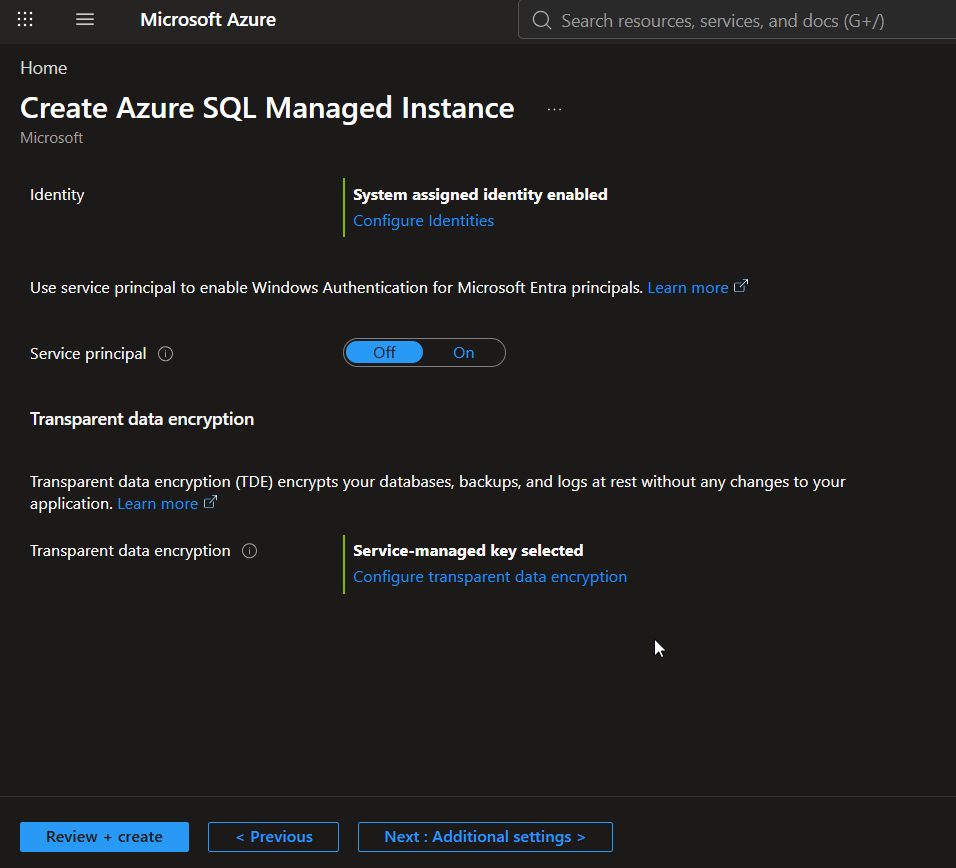

### 5.5. Revisar e implantar

1.  Clique em **Review + create / Revisar + criar**.
2.  Aguarde a validação.
3.  Confira região, rede, computação, armazenamento, autenticação e
    preço estimado.
4.  Clique em **Create / Criar** para iniciar a implantação.

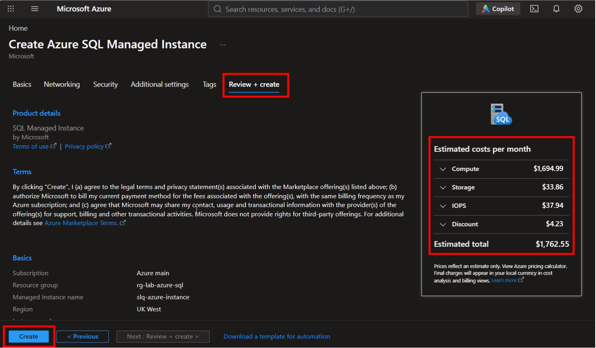

## 6. Acompanhar a implantação

Acompanhe o progresso pelas notificações do Portal Azure ou pela página
do recurso/grupo de recursos.

O provisionamento de uma Managed Instance pode levar um período
considerável --- não é necessariamente imediato. Consulte os tempos de
operação documentados pela Microsoft e aguarde o estado indicar que o
recurso está pronto antes de prosseguir.

Após a conclusão, abra a instância e revise a página **Overview / Visão
geral**.

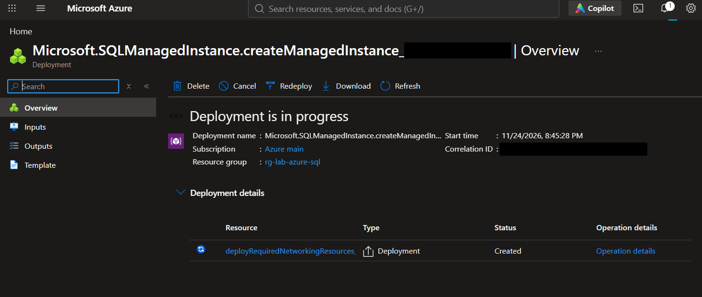
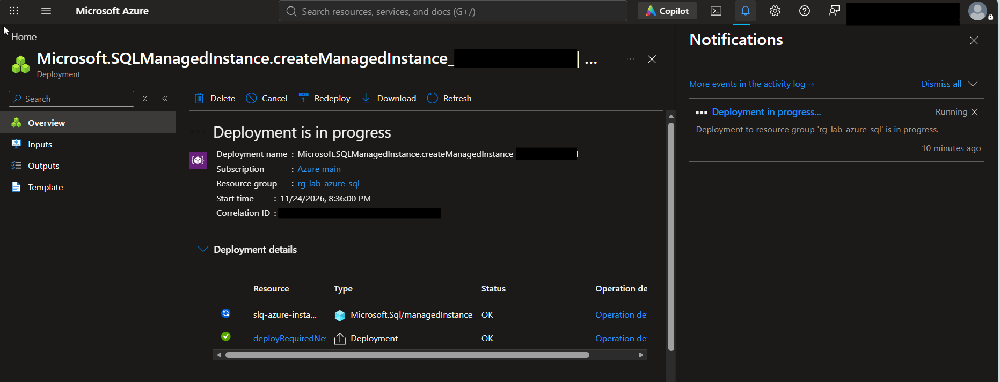
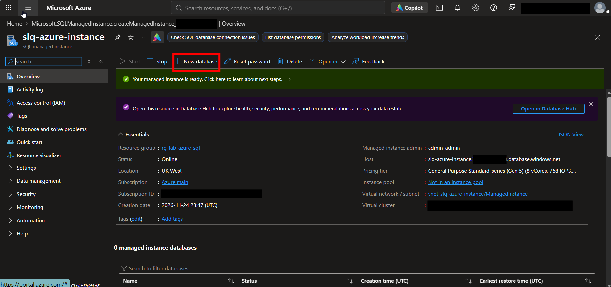

## 7. Criar um banco de dados

Com a instância provisionada:

1.  Abra o recurso da SQL Managed Instance.
2.  Na página **Overview / Visão geral**, selecione **+ New database /
    Novo banco de dados**.
3.  Informe um nome para o banco.
4.  Selecione a origem de dados (por exemplo, banco vazio, quando
    disponível).
5.  Revise as opções e clique em **Review + create**.
6.  Confirme a criação.

O banco será criado dentro da instância gerenciada.

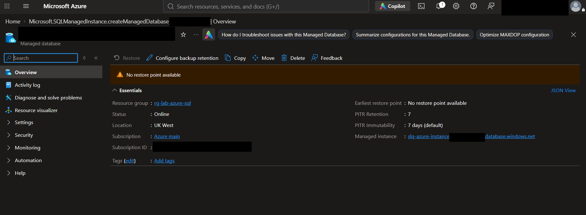

## 8. Obter informações de conexão

Na página de visão geral ou nas propriedades da instância, consulte o
hostname/endereço e as informações de conectividade disponíveis para a
configuração realizada.

Para conectar-se, você precisará considerar:

-   Hostname ou endpoint da instância.
-   Banco de dados.
-   Método de autenticação.
-   Credenciais (quando aplicável).
-   Conectividade de rede com a VNet ou endpoint configurado.

A instância não estará necessariamente acessível a partir de qualquer
computador conectado à internet. Dependendo da configuração, pode ser
necessário estar conectado à rede Azure, configurar VPN, uma VM na VNet,
ou outro caminho de conectividade suportado.

Use um cliente SQL compatível e teste a conexão somente depois de
confirmar os requisitos de rede e segurança.

**Nunca publique credenciais, strings de conexão com senha, tokens ou
dados sensíveis no repositório.**

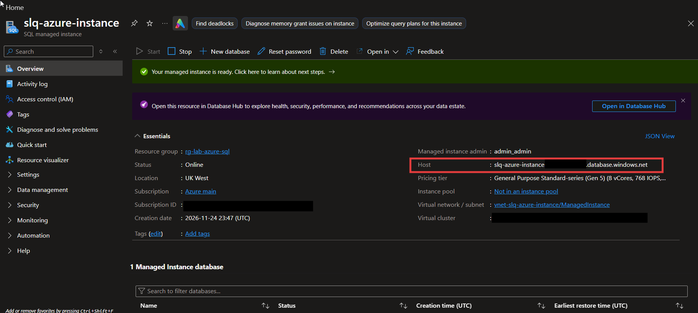

> Para mais informações de como conectar na instância, visite o [Learn Microsoft](https://learn.microsoft.com/pt-br/azure/azure-sql/managed-instance/connect-application-instance?view=azuresql)

## 9. Segurança: boas práticas

-   Prefira autenticação Microsoft Entra quando apropriada ao cenário.
-   Não habilite acesso público sem necessidade.
-   Restrinja o tráfego de rede a origens confiáveis.
-   Use senhas fortes e não as armazene no README ou em arquivos
    versionados.
-   Não inclua dados pessoais, sensíveis ou confidenciais em nomes, tags
    ou exemplos.
-   Para projetos reais, avalie políticas de backup, recuperação,
    monitoramento, alta disponibilidade e controle de acesso.

## 10. Custos e limpeza dos recursos

Azure SQL Managed Instance pode ter custos elevados, especialmente
durante e após a implantação, conforme computação, armazenamento,
licenciamento, região e outros recursos.

Antes de iniciar:

-   Consulte a calculadora de preços e a estimativa exibida no Portal.
-   Verifique se a assinatura possui créditos ou ofertas elegíveis e
    suas condições.
-   Defina um orçamento/alerta de custos, quando possível.

**Ao terminar o laboratório, exclua os recursos que não serão mais
utilizados**, especialmente a Managed Instance e recursos de rede
criados exclusivamente para este exercício. Verifique o grupo de
recursos antes de excluí-lo para não remover recursos de outros
projetos.

Referências: - [Calculadora de preços
Azure](https://azure.microsoft.com/pt-br/pricing/calculator/) -
[Gerenciar custos com o Azure Cost
Management](https://learn.microsoft.com/pt-br/azure/cost-management-billing/costs/overview-cost-management)

## 11. Referências

-   [Microsoft Learn --- Início Rápido: criar Instância Gerenciada de
    SQL do
    Azure](https://learn.microsoft.com/pt-br/azure/azure-sql/managed-instance/instance-create-quickstart?view=azuresql&tabs=azure-portal)
    --- guia principal deste tutorial.
-   [Microsoft Learn --- Getting started with Azure SQL Managed
    Instance](https://learn.microsoft.com/en-us/azure/azure-sql/managed-instance/quickstart-content-reference-guide?view=azuresql)
    --- materiais introdutórios e próximos passos.
-   [Microsoft Learn --- Criar Azure SQL Managed Instance usando ARM
    Template](https://learn.microsoft.com/en-us/azure/azure-sql/managed-instance/create-template-quickstart?view=azuresql)
    --- alternativa de implantação por infraestrutura como código.
-   [GitHub Quickstart --- Digital Innovation
    One](https://github.com/digitalinnovationone/github-quickstart) ---
    apoio para organizar e publicar o repositório.

------------------------------------------------------------------------

**Conclusão:** este laboratório permite conhecer o processo de
provisionamento de uma Azure SQL Managed Instance, compreender os
principais parâmetros de computação e rede e registrar evidências de uma
implantação. Para cenários reais, aprofunde-se em segurança,
conectividade privada, dimensionamento, custos, backups, monitoramento e
automação.
